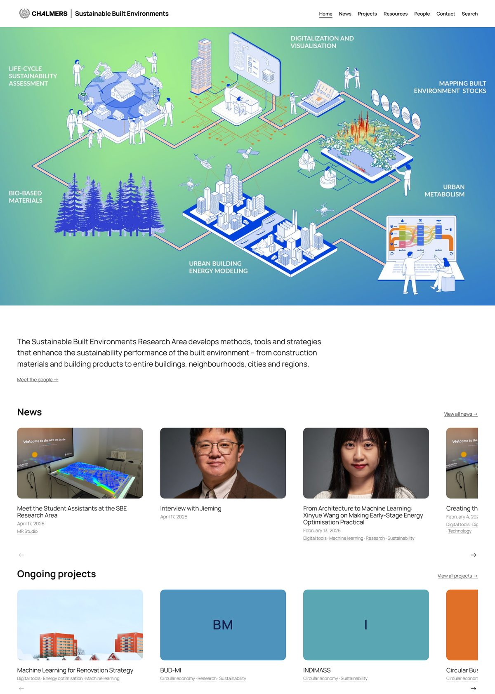
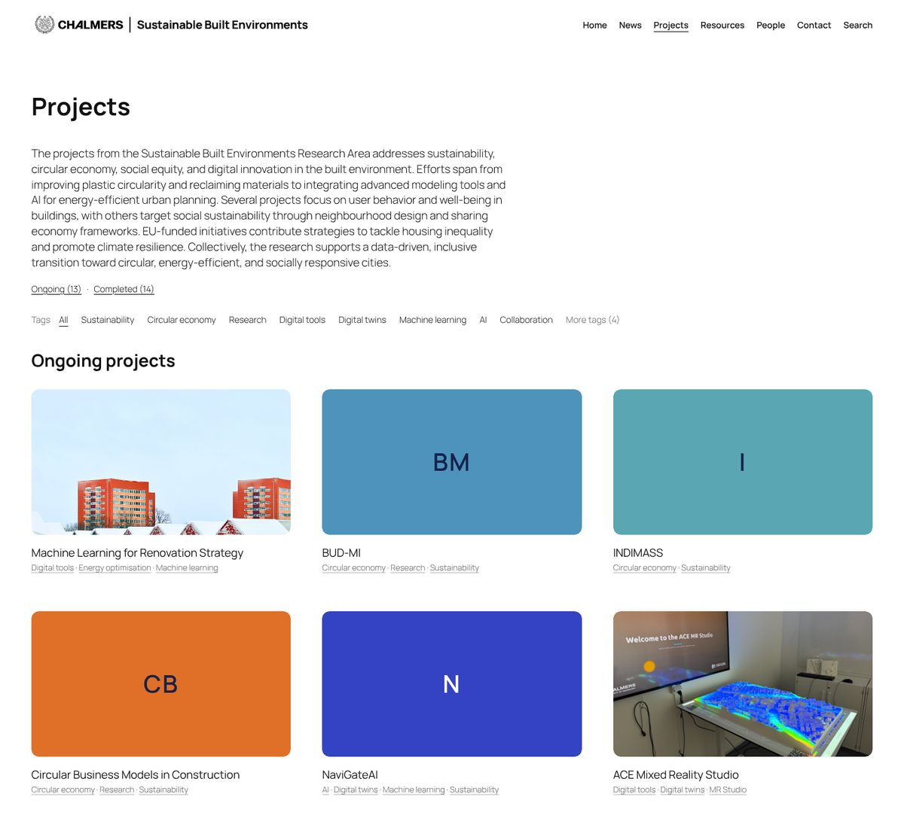
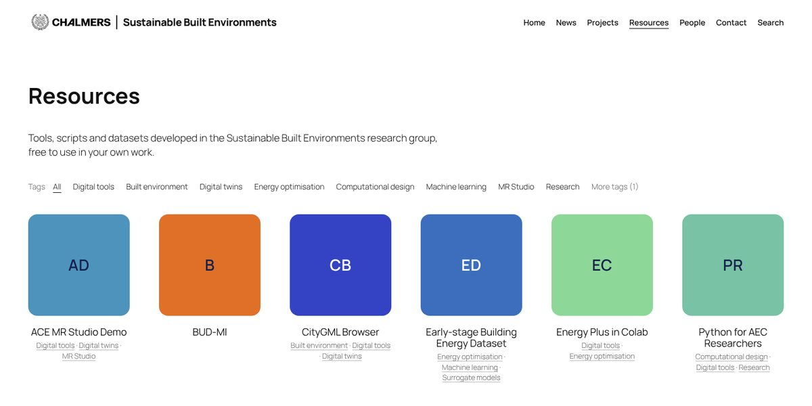
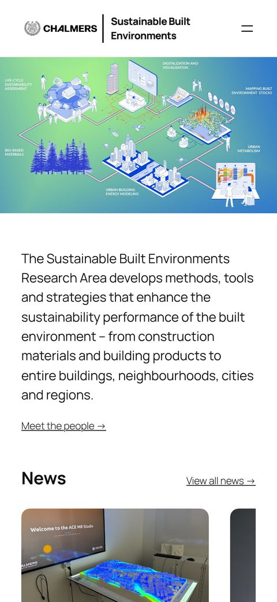

# SBE website kit

The WordPress plugin and theme behind the website of the **Sustainable Built Environments** research area at Chalmers ([sb.chalmers.se](https://sb.chalmers.se)), packaged so other divisions and research groups can set up a site that works and looks the same, with their own content.

## What you get

- **Projects** with an Ongoing / Completed status, a second title, "Read more" links and the people involved.
- **People**: staff profiles in groups (researchers, student assistants, alumni …) on a People page. People can be tagged on news, projects and resources.
- **Resources**: tools and datasets with an icon and a link to the repository.
- **News** with categories, and **tags** shared by news, projects and resources. Each list has a tag filter and each tag has its own page.
- **Related content** under every post, project and resource, picked by shared tags.
- **Publications** on any post, project or resource, typed in or pasted as BibTeX.
- **Site search** across news, projects and resources.
- **A simple editor**: one "Add content" sidebar, ready-made content sections, and a Help page in the admin.
- **The design**: full-width layout, Manrope, a sticky header, rounded gallery cards that zoom on hover, galleries that adapt from phone to large screen, and coloured placeholders for items without a picture.

## What's in this repository

| Folder | What it is |
| --- | --- |
| [`plugin/sbe-projects/`](plugin/sbe-projects/) | The **SBE Projects** plugin: post types, blocks, templates, editor tools and the documentation (`docs/`) |
| [`theme/sbe-theme/`](theme/sbe-theme/) | The **SBE Theme**, a child theme of Twenty Twenty-Five with the site's design, templates, header and footer, plus starter pages |
| [`SETUP.md`](SETUP.md) | Step-by-step guide to setting up a new site |
| [`docs/images/`](docs/images/) | Screenshots used in this README |

## Quick start

1. Use a WordPress site where you are allowed to upload plugins and themes. To try it locally first, use [WordPress Studio](https://developer.wordpress.com/studio/).
2. Zip `plugin/sbe-projects` and upload it under **Plugins → Add New → Upload Plugin**, then activate it.
3. Zip `theme/sbe-theme` and upload it under **Appearance → Themes → Add New → Upload Theme**, then activate it.
4. Click **Create the pages** in the notice at the top of the dashboard.
5. Add your logo, site title, footer text and content.

Full instructions, including what to change afterwards: **[SETUP.md](SETUP.md)**.

## Screenshots

**Projects page**: intro, Ongoing / Completed counts, tag filter and galleries.

**A project page**: second title, status, picture and text in one readable column. "Read more" links, the people involved, tags and related content follow below.

**Resources** with their icons. Items without a picture get a coloured placeholder.

**On a phone**, the menu collapses into a button and the galleries become one large card per row. Home keeps side-scrolling rows.

 

## Requirements

- WordPress with the block editor and Site Editor. Tested on WordPress 7.1 with PHP 8.3.
- The **Twenty Twenty-Five** theme must be installed. It comes with WordPress and the SBE Theme builds on it.
- Permission to upload plugins and themes. Some hosts don't allow this; on WordPress.com it needs a plan with plugin support.
- No other plugins needed.

## Documentation

The plugin ships with its own documentation in [`plugin/sbe-projects/docs/`](plugin/sbe-projects/docs/). Once installed, it is also shown in WordPress under **Help**:

- **EDITOR-GUIDE.md**: how to add posts, projects, resources and people.
- **POSTS-AND-PROJECTS-TUTORIAL.md**: a one-page quick start for editors.
- **BUILD-NOTES.md**: how the site is built, for whoever maintains it.

These files describe sb.chalmers.se, so some details (page names, staff groups, old URLs) are specific to SBE. Edit your copy to match your site.

## Keeping in step with sb.chalmers.se

The SBE site is the reference. When the plugin changes there, the new version is copied into `plugin/` here. Design changes are copied into `theme/sbe-theme/`. To update your site, upload the new zip and choose **Replace current with uploaded**. Anything you changed yourself in the Site Editor is stored in your database and is kept.

## Contact

Maintained by the Sustainable Built Environments research area, Department of Architecture and Civil Engineering, Chalmers University of Technology. Questions and suggestions: open an issue in this repository.

## License

GPL v2 or later, like WordPress itself.
